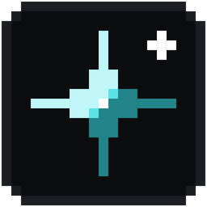

<p align="center">
  
</p>

<h1 align="center">Glint</h1>

<p align="center">A fast, good-looking launcher for Minecraft: Java Edition.<br>
Separate instances like Prism, Modrinth built in, pixel-style design, no paid features.</p>

---

> **Status:** early development. Windows first, Linux next. Not affiliated with Mojang or Microsoft.

## Features

- **Instances.** Every game is its own copy, with its own version, mod loader, worlds, settings and Java. Run several at once.
- **Mod loaders.** Fabric, Quilt, Forge and NeoForge are installed for you.
- **Discover.** Search Modrinth for mods, resource packs and shaders. Each one has a full page with its description, gallery, versions and changelogs. Required dependencies install along with it, and shader packs bring Iris or Oculus.
- **Content management.** Enable, disable, update or remove anything, drop files onto the window, and update everything at once.
- **Worlds and servers.** Back up, duplicate and rename worlds. Ping servers to see the MOTD, players online and latency. Jump straight into a world or server with Quick Play.
- **Home dashboard.** Recent worlds and servers, screenshots, playtime, pending updates, popular mods for your version, and Minecraft news and patch notes.
- **Library.** Search, sorting and groups for your instances.
- **Screenshots, logs and notes.** A screenshot viewer, a live and searchable game log, old logs and crash reports, and per-instance notes.
- **Launch settings.** Memory, JVM arguments, Java path, window size, auto-join, environment variables, and pre-launch, wrapper and post-exit hooks.
- **Make it yours.** Three themes, custom accent and tint, saved and shareable themes, background pictures, cover images, interface scale, corner style and motion settings.
- **Horizon (experimental, Dev builds).** Run an instance on Horizon, a Rust implementation of the Minecraft client, instead of Java.
- **Players.** Offline names and Ely.by accounts. Microsoft sign-in is planned.

## Building

Requirements: [Rust](https://rustup.rs) (stable, edition 2024), [Node.js](https://nodejs.org) 20+, and on Windows the WebView2 runtime (included in Windows 11).

```sh
cd apps/desktop
npm install
npx tauri dev            # run in development
```

Release channels. Each one installs as its own app (`Glint Dev`, `Glint Beta`, `Glint`), and they share instances and settings:

| Channel | For | Build |
|---|---|---|
| Dev | developers, experimental features on | `scripts/build.ps1 -Channel dev` |
| Beta | testers, stable features only | `scripts/build.ps1 -Channel beta` |
| Public | everyone | `scripts/build.ps1 -Channel public` |

Installers land in `dist/<channel>/`. `scripts/install-local.ps1` builds the Dev exe and puts Glint shortcuts on the desktop and in the Start menu.

Checks:

```sh
cargo test --workspace
cargo clippy --workspace --all-targets
cd apps/desktop && npx tsc --noEmit
```

## Project layout

```
apps/desktop/          Tauri app: src-tauri/ (Rust commands), src/ (React UI)
crates/
  glint-core           shared models (instances, accounts), paths, errors
  glint-instance       creating, listing and editing instances
  glint-meta           Mojang manifests, libraries, assets and install plans
  glint-java           Java runtimes Mojang publishes per version
  glint-loader         Fabric, Quilt, Forge and NeoForge
  glint-launch         launch command, game process, play sessions
  glint-modrinth       Modrinth search, installs with dependencies, updates
  glint-gamedir        worlds, servers, screenshots and logs in a game folder
  glint-horizon        Horizon builds and resources
  glint-auth           offline and Ely.by accounts
  glint-net            HTTP client and verified downloads
docs/
  ARCHITECTURE.md      architecture and roadmap
  DESIGN.md            design system: tokens, components, motion, patterns
```

The Tauri layer stays thin: logic lives in the crates, which know nothing about Tauri and are tested on their own. Data is kept in `%APPDATA%\Glint`.

## License

[GPL-3.0-or-later](https://www.gnu.org/licenses/gpl-3.0.html). Minecraft is a trademark of Mojang AB. Glint is not an official Minecraft product and is not approved by or associated with Mojang or Microsoft.
